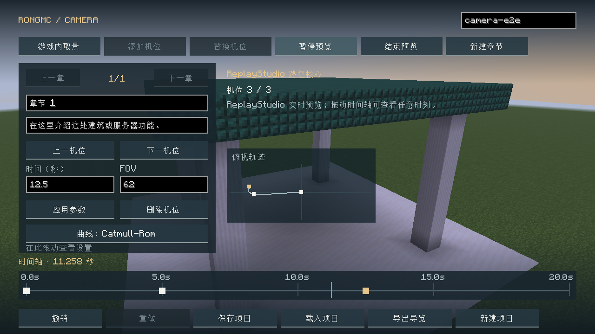

# 运镜编辑器（0.4）

使用 ReplayMod 项目 ReplayStudio 的实际关键帧/路径/插值核心，在实时 Minecraft 世界中制作欢迎导览运镜。编辑器界面是 RongMC 原生 Screen；无需安装完整 ReplayMod、录制回放或手填镜头坐标。

## 开始制作

在安装 RongMC 模组的 Fabric 1.21.11 客户端和配套服务端中使用。单人世界需允许命令；服务器需管理员权限。预览还要求玩家处于创造或旁观模式，不会授予管理员权限。新版服务端在已授权的相机路线上临时移动旁观锚点来加载区块，并在结束时恢复原位置和模式。

1. 飞到第一个机位，调好朝向和游戏 FOV。
2. 按 **F8** 打开编辑器，点击“添加机位”；或者在游戏中直接按 **F7**。第一帧时间为 0 秒。
3. 点击“游戏内取景”，飞到下一机位，按 **F7** 记录。新增机位默认间隔 5 秒。
4. 按 F8 回编辑器。选择关键帧后可编辑时间、FOV、章节标题和介绍，点击“应用参数”。也可直接拖动时间轴上的关键帧改变时间。
5. 选择曲线并点击“播放预览”。可以暂停、拖动空白时间轴定位，或结束预览继续取景。
6. 填写右上角项目文件名，保存项目；内容完成后点击“导出导览”。

可以在控制设置中重新绑定 F7/F8。默认 F8 和 Esc 可关闭编辑器。非输入框聚焦时，Space 播放/暂停，Delete 删除选中机位，Ctrl+Z / Ctrl+Shift+Z / Ctrl+Y 撤销重做，Ctrl+S 保存。

## 时间轴与曲线

时间轴方块是记录的机位，红色竖线是预览位置。点击机位可选中，点击空白位置可查看该时间的画面。拖动机位时保持时间顺序，首帧固定为 0，拖动以 0.05 秒为步长；一次完整拖动对应一次撤销。数值输入可精确到毫秒。

- **Catmull-Rom**：使用 ReplayStudio 的样条插值，适合连续多机位的平滑运动。
- **线性**：使用 ReplayStudio 的线性插值，适合匀速直线。
- **缓入缓出**：保留 RongMC 旧版逐段缓动，兼容已有导览。

右侧提供俯视轨迹图；小窗口时隐藏轨迹图以留出编辑空间。左侧参数区可滚动，导览版本与删除章节入口在参数区下部。上一/下一机位按钮可选择时间很接近的机位。

同一章节不再限制机位到锚点的水平距离或垂直落差，也不再把样条裁剪到 24 格内；章节可以覆盖整段长路线。轨迹图会自动缩放以容纳整条曲线。仍保留 Minecraft 的绝对坐标范围、世界边界和数据大小校验；俯仰限制 -85–85 度，FOV 限制 30–100。

客户端和服务端都使用 0.4 时，预览与正式导览会让服务端观测点跟随已验证路线上的时间位置，按需加载周围区块，避免一次性加载整条路线。等待区块和渲染网格时覆盖画面并暂停镜头时钟，就绪后继续；结束、断线、超时或权限被撤销时恢复原位置与模式。

连接旧版 0.3 服务端时，也能无距离上限地录制、编辑、保存和导出，已加载区块内可本地预览。跨区块预览与部署长距离欢迎导览需要配套服务端更新到 0.4；不会尝试向旧服发送未注册的数据包。已按用户要求保持现有测试服不变，仅更新本机客户端。

## 项目、章节与恢复

“新建章节”保留现有章节，为下一处建筑建立独立路线和锚点；第一帧记录时读取当前世界维度与玩家位置。“上一章/下一章”切换章节；每章可独立选择曲线与介绍文字。

保存草稿允许未完成的章节，导出则要求每章至少两个有效机位。修改旧项目或导出文件前保留上一版本 `.bak`。自动草稿存储于 `config/rongmc-camera/autosave.json`，再次打开时尝试恢复。新建项目、删除机位与删除章节均可撤销，历史最多 64 步。

- 项目：`config/rongmc-camera/projects/<文件名>.json`
- 导览配置：`config/rongmc-camera/exports/<文件名>.json`

文件名只允许小写字母、数字、下划线和短横线，避免把输入解释为文件路径。取景需要回到该章节所在的世界维度；载入项目不会自动传送玩家。

## 用于欢迎导览

导出的 JSON 包含所有章节、文字、机位和曲线。把它用于服务端 `config/rongmc-tour-server.json`。导出时 `enabled` 默认是 false，确认实景、设置版本和检查认证流程后再启用并执行 `/rongmctour reload`。编辑器不会自动覆盖或发布服务端配置。

预览和正式导览使用相同的插值代码。预览结束、关闭界面、切换世界或断线时恢复 HUD、视角模式等临时设置；新版服务端同步恢复旁观锚点和模式，持久化返回点供中断恢复。编辑器预览不会写入首次欢迎完成记录。正式导览仍由服务端管理场景、玩家保护及完成记录。

管理员也可以使用 `/rongmctour editor` 打开编辑器。没有配套服务端或没有管理员权限时，请求会被拒绝；普通玩家仍可正常观看配置好的欢迎导览。

## 上游来源

ReplayStudio 是 ReplayMod 使用的路径核心，源码来源固定在 [a2e312635cd305d0dd57218b810c6088b59c18b0](https://github.com/ReplayMod/ReplayStudio/tree/a2e312635cd305d0dd57218b810c6088b59c18b0)，采用 LGPL-3.0-or-later。项目在 `third_party/replaystudio-pathing/` 保留选取的原始 Java 文件、许可证及 SHA-256 清单，使用独立可替换的嵌套 Jar，并随 Jar 提供该组件的对应源码和构建脚本。

本编辑器没有复制完整 ReplayMod 的 GUI、录像、回放世界、视频导出或网络协议转换功能。

为避免与完整 ReplayMod 同时安装时发生同名类冲突，独立库编译时会隔离 Java 包名；原始源文件保留不变，变换规则包含在对应源码归档的构建脚本中。尚未宣称已验证完整 ReplayMod 的所有运行模式或其他整合包模组。

## 已准备的示例

在开发客户端打开“RongMC 导览原型测试”存档，按 F8，将右上角项目文件名改为 `preview`，点击“载入项目”，然后播放预览。该项目只引用自动生成的测试展亭；项目格式副本位于 `examples/camera-project-preview.json`。

