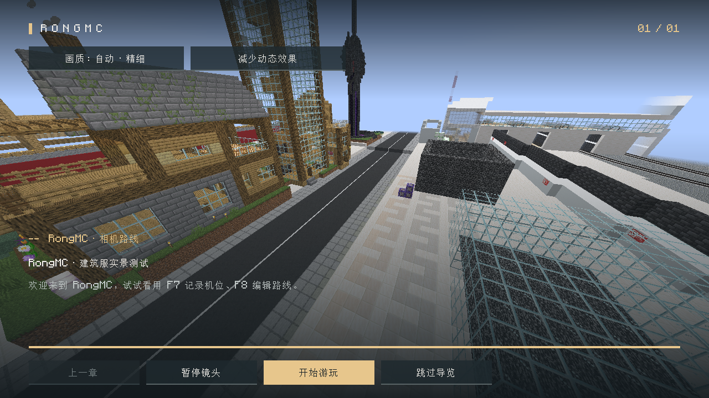

# 远端建筑服实装与实测（2026-11-09）

目标目录为远端 `/home/rong/RongMC_Update/migration-bundle/external-instances/建筑服-1.21.11`。

已安装到 `client-run/mods/` 与 `server/mods/`，两端均为 `rongmc-client-0.3.0-dev.jar`。实际运行栈为 Minecraft 1.21.11、Fabric Loader 0.19.5、Fabric API 0.141.6。设备使用已安装的 Java 25；兼容性实测通过。标题页已有的可选模组欢迎页保留，并部署其工程中已编译的模糊渲染修复构建。

用户确认使用 `server/world`。实际联机测试运行于它的独立副本，约 2 GiB，没有让测试进程打开原存档。隔离运行目录为上述目标下 `rongmc-camera-deployment/20261109-235146`；实际模组清单完整保留，测试服暂时排除 EasyAuth。原服务端中的 EasyAuth 在测试后已经恢复，数据库未改。测试客户端与测试服务端保持运行，客户端停在运镜编辑器。

## 已验证

- 真实整合包服务端启动、客户端联机，F7 录制三个机位、F8 打开管理员编辑器。
- UI 修改参数、保存项目、导出 JSON；ReplayStudio Catmull-Rom 预览、结束预览。
- 设备检测和覆盖式自动画质校准；当前机器日志 LOW → BALANCED → HIGH，初次校准 p95 为 5 ms，后续自动档仍按实际负载调整。
- 实景导览暂停、固定视角、完成、跳过；退出恢复原位置，恢复队列为空；跳过测试前后 options.txt 文件 SHA-256 相同。
- 非管理员 F8 请求被拒绝；原标题欢迎页与可选模组页实际渲染正常，没有重复模糊崩溃。
- 五个修正或新增的启动脚本均通过 bash 语法检查。

## 现在怎么用

F7 记录机位，F8 打开编辑器，也可 `/rongmctour editor`。文件名 `rongmc-test` 已保存真实出生区域的三机位、十秒示例。`/rongmctour` 手动观看这条导览。

实际 `server/config/rongmc-tour-server.json` 已配置手动测试路线，`autoStartOnFirstJoin=false`；首次入服自动导览等待正式路线确认后启用。客户端 `config/rongmc-camera/projects/rongmc-test.json` 与 `exports/rongmc-test.json` 已保留制作项目及原始默认关闭的导出件。整合包既有 MTR 渲染诊断同样默认使用 F8，需要时可在控制设置重新绑定。

## 启动与备份

原实例 `client-run/start-client.sh`、`start-client-test.sh` 和 `server/start.sh` 已修正迁移失效路径、当前 PortableMC 参数与 Java 17 默认版本的问题。备份在隔离运行目录 `backup/`。

隔离运行目录包含 `start-isolated-client.sh`、`start-isolated-server.sh`、`deployment-verification.json`、`README.md` 与实际测试日志和截图。原目录下 `notes/rongmc-camera-deployment-2026-11-09.md` 也记录了安装与恢复方式。旧隔离测试 JVM 在正常保存关闭后被 WorldEdit 非守护线程滞留；已在用户明确批准后结束，当前仅保留正在使用的一组客户端与服务端。

